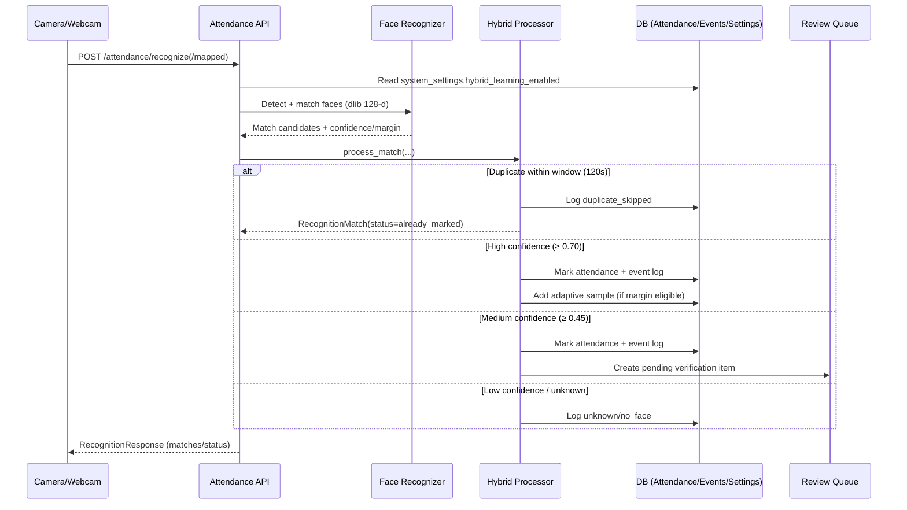

# AI-Based Face Recognition Attendance System

School attendance platform with face recognition, rule-based attendance processing, parent notification logging, and a React admin dashboard.

## Tech Stack

**Backend**

| Layer | Technology |
|---|---|
| Runtime | Python 3.11 |
| Framework | FastAPI 0.115 |
| ORM | SQLAlchemy 2.0 |
| Database | MySQL / MariaDB (XAMPP) |
| Migrations | Alembic |
| Auth | JWT (`python-jose`) + Passlib bcrypt |
| Face Recognition | dlib 128-d embeddings via `face_recognition` + `dlib-bin` |
| Encryption | Fernet AES-128 (`cryptography`) |
| Task Queue | In-process scheduler + queue worker |
| Package Manager | uv |

**Frontend**

| Layer | Technology |
|---|---|
| Framework | React 18 |
| Language | TypeScript |
| Build tool | Vite |
| Styling | Tailwind CSS |
| State / Data | TanStack Query (React Query) |
| HTTP client | Axios |
| Charts | Recharts |

## Features

- FastAPI backend with SQLAlchemy and MySQL (XAMPP/MariaDB)
- dlib-based face recognition (128-d embeddings via `face_recognition` library)
- Hybrid learning processor: high/medium/low confidence paths with adaptive sampling
- Fernet AES encryption for face encodings at rest
- Attendance domain engine (check-in/check-out, status calculation)
- Parent notification subsystem (console provider; SMTP/SMS adapters ready)
- Continuous gate mode webcam scanning with multi-frame voting
- Student CSV bulk import and attendance export (CSV/XLSX)
- Manual attendance override and audit trail
- Daily/weekly/monthly analytics with graph pages
- Queue-based recognition ingestion with runtime scheduler
- Multi-camera device/location mapping
- Role-based access (`admin`, `teacher`) with rate-limited login
- React + Vite + Tailwind admin dashboard

## Repository Layout

```
apps/
  backend/   FastAPI backend service
  frontend/  React admin application
infra/
  attendance_db.sql   Database schema reference
```

## Local Development Setup

### Prerequisites

- [XAMPP](https://www.apachefriends.org/) (MySQL/MariaDB)
- [Python 3.11+](https://www.python.org/)
- [uv](https://docs.astral.sh/uv/) — fast Python package manager (`pip install uv`)
- [Node.js 18+](https://nodejs.org/)

### 1. Database

Start MySQL in XAMPP, then create the database:

```sql
CREATE DATABASE IF NOT EXISTS school_management;
```

Import the schema:

```bash
mysql -u root school_management < infra/attendance_db.sql
```

### 2. Backend

```bash
cd apps/backend

# Copy and edit environment variables
copy .env.example .env   # Windows
# cp .env.example .env   # Mac/Linux

# Install dependencies (creates .venv automatically)
uv sync

# Install face recognition extras (dlib pre-built wheel, no CMake needed)
uv sync --extra ai

# Start the server
uv run uvicorn app.main:app --host 0.0.0.0 --port 8000
```

Key `.env` values to configure:

| Variable | Description |
|---|---|
| `DATABASE_URL` | `mysql+pymysql://root:@localhost:3306/school_management` |
| `JWT_SECRET_KEY` | Random 64-char hex string |
| `FACE_ENCODING_ENCRYPTION_KEY` | Fernet key (`python -c "from cryptography.fernet import Fernet; print(Fernet.generate_key().decode())"`) |
| `ALLOWED_ORIGINS` | Frontend URL, e.g. `http://localhost:5173` |

### 3. Frontend

```bash
cd apps/frontend
npm install
# Copy and edit environment variables
copy .env.example .env   # Windows
# cp .env.example .env   # Mac/Linux
npm run dev
```

Frontend: `http://localhost:5173`  
Backend: `http://localhost:8000`

## Face Recognition Notes

- Uses **dlib only** (`dlib-bin` pre-built wheel). No OpenCV required.
- Upload 3–5 clear frontal photos per student through the student face-upload flow.
- Use varied lighting and slight pose variation for better matching robustness.
- Tolerance default: `0.65` (lower = stricter). Adjust via `FACE_MATCH_TOLERANCE` in `.env`.

### Hybrid Learning Thresholds

The confidence formula is `1 - (distance / tolerance)`. Real-world dlib distances for good matches are typically `0.15–0.30`, giving confidence of `55%–77%`. The thresholds are calibrated accordingly:

| Setting | Default | Meaning |
|---|---|---|
| `HYBRID_HIGH_CONFIDENCE_THRESHOLD` | `0.70` | Distance ≤ 0.195 — marks attendance + adaptive sample |
| `HYBRID_MEDIUM_CONFIDENCE_THRESHOLD` | `0.45` | Distance ≤ 0.357 — marks attendance + flags for review |
| Below medium | — | Logged as unknown, no attendance marked |

Hybrid learning can be toggled at runtime via the Setup page (Settings → Notifications & Hybrid Learning).

## Hybrid Recognition Flow



## API Reference

Base path: `/api/v1`

| Method | Path | Auth | Description |
|---|---|---|---|
| GET | `/health` | — | Health check |
| POST | `/auth/login` | — | Get JWT token |
| GET | `/auth/me` | any | Current user |
| GET/POST/PUT/DELETE | `/students` | admin | Student management |
| POST | `/students/{id}/face` | admin | Upload face images |
| POST | `/attendance/recognize` | admin/teacher | Webcam frame recognition |
| POST | `/attendance/recognize/mapped` | admin/teacher | Mapped camera recognition |
| POST | `/attendance/recognize/enqueue` | admin/teacher | Queue-based ingestion |
| GET | `/attendance/recognition-metrics` | admin | Recognition accuracy |
| GET | `/attendance` | admin | Attendance records |
| PUT | `/attendance/{id}/override` | admin/teacher | Manual override |
| GET | `/attendance/export` | admin/teacher | CSV/XLSX export |
| GET | `/analytics/daily` | admin/teacher | Daily stats |
| GET | `/analytics/weekly` | admin/teacher | 7-day trend |
| GET | `/analytics/monthly` | admin/teacher | Monthly heatmap |
| GET/PUT | `/rules` | admin | School time rules |
| GET/POST/PUT | `/cameras` | admin | Camera device mapping |
| GET | `/notifications` | admin | Notification feed |
| GET | `/audit` | admin | Audit trail |
| GET/PUT | `/settings/notifications` | admin | SMTP/SMS + Hybrid setup |

## Attendance Status Logic

| Status | Condition |
|---|---|
| `Present` | Check-in + check-out, minimum hours met, on time |
| `Late` | Check-in + check-out, minimum hours met, check-in after threshold |
| `Half-day` | Check-in + check-out, below minimum hours |
| `Pending` | Check-in recorded, check-out not yet received |
| `Absent` | No check-in by end of day |

Rules configurable via `/api/v1/rules`.

## Default Credentials

| Role | Username | Password |
|---|---|---|
| Admin | `admin` | `Admin@123` |
| Teacher | `teacher` | `Teacher@123` |

Change these in `apps/backend/.env` before production.

## Security

- JWT role checks on all sensitive endpoints
- Login rate limiting per client IP (10 req/min)
- Security response headers (X-Frame-Options, X-Content-Type-Options, Referrer-Policy)
- Duplicate mark prevention window (120s per device)
- Face encoding encryption-at-rest (Fernet AES-128)
- Keep `JWT_SECRET_KEY` strong, run behind HTTPS, restrict DB access in production

## Roadmap — Upcoming Features

This project is evolving into a **complete multi-tenant school management system**. Planned modules:

### Multi-Tenancy
- [ ] School / organisation isolation (tenant per schema or per row)
- [ ] Super-admin portal for onboarding new schools
- [ ] Per-tenant branding (logo, school name, timezone)
- [ ] Subscription and plan management

### Student Information System
- [ ] Full student profiles (address, emergency contacts, medical notes)
- [ ] Class and section management with timetable builder
- [ ] Teacher assignment and subject mapping
- [ ] Academic year / term configuration

### Fees Management
- [ ] Fee structure builder (tuition, transport, lab, etc.)
- [ ] Per-student fee ledger and payment tracking
- [ ] Installment plans and due-date reminders
- [ ] Receipt generation (PDF)
- [ ] Overdue alerts sent to parents via SMS / email

### Notifications & Communication
- [ ] Real-time parent notifications (check-in, check-out, absence, late arrival)
- [ ] Bulk SMS and email broadcast to class or school
- [ ] In-app announcement board for teachers and admins
- [ ] WhatsApp Business API integration (optional)

### Examinations & Results
- [ ] Exam schedule management
- [ ] Marks entry and grade calculation
- [ ] Report card generation (PDF)
- [ ] Student performance analytics per subject and term

### Payroll & Staff Management
- [ ] Staff profiles (teachers, support staff)
- [ ] Salary structure and monthly payroll processing
- [ ] Leave management (casual, sick, earned)
- [ ] Payslip generation (PDF)

### Library Management
- [ ] Book inventory and catalogue
- [ ] Issue / return tracking with due-date alerts
- [ ] Fine calculation for overdue returns

### Transport Management
- [ ] Route and vehicle management
- [ ] Student-to-route assignment
- [ ] Driver and vehicle tracking integration (GPS ready)

### Face Recognition Improvements
- [ ] Liveness detection / anti-spoofing
- [ ] GPU-accelerated inference (CUDA dlib build)
- [ ] Confusion-matrix accuracy reports per class
- [ ] Multi-face classroom scan mode

### Infrastructure
- [ ] Docker Compose for local and production deployment
- [ ] REST API versioning (v2 with OpenAPI 3.1 spec)
- [ ] Webhook support for third-party integrations
- [ ] Mobile app (React Native) for parents and teachers
