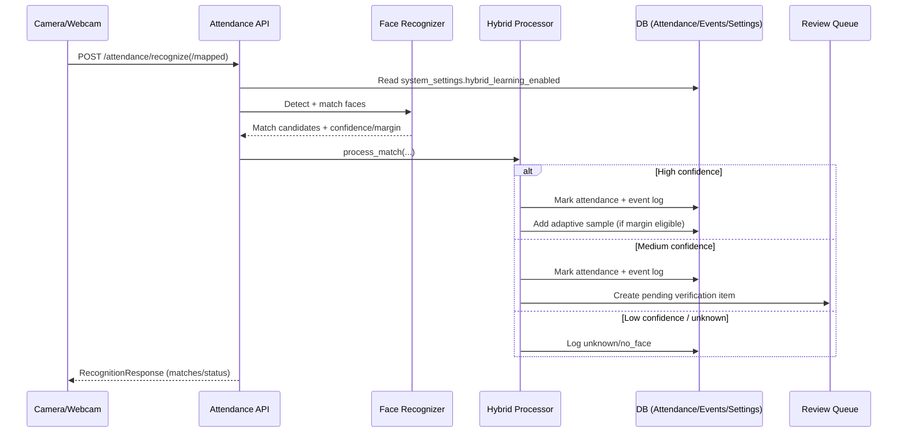

# AI-Based Face Recognition Attendance System

School attendance platform with face recognition, rule-based attendance processing, parent notification logging, and a React admin dashboard.

## What Has Been Delivered

- Backend API with FastAPI, SQLAlchemy, MySQL support
- Attendance domain engine (check-in/check-out, status calculation)
- Notification subsystem abstraction (console provider implemented; Twilio/SMTP adapters ready to plug in)
- Student, face-encoding, attendance, rule, and notification APIs
- Improved face matching logic with sample-aware scoring and margin checks
- Dashboard includes recognition accuracy percentage
- Continuous gate mode for webcam scanning (no per-student button press)
- Student CSV bulk import + sample sheet download
- Manual attendance override API and UI
- Attendance export to CSV/XLSX
- Unknown-face admin alerts in notification feed
- Role split support (`admin`, `teacher`) with rate-limited login
- Daily/weekly/monthly analytics APIs with graph pages
- Queue-based recognition ingestion (`enqueue` + worker processing + retry)
- Runtime scheduler for queue polling and daily summary notifications
- Face encoding encryption-at-rest support
- Audit trail model and audit log page
- Multi-camera device/location mapping screens
- React + Vite + Tailwind admin dashboard with operational modules
- Infrastructure scripts for local setup with XAMPP MySQL
- CI workflow for backend sanity checks and frontend build

## Repository Layout

- [apps/backend](apps/backend): FastAPI backend service
- [apps/frontend](apps/frontend): React admin application
- [infra/docker](infra/docker): Local infrastructure definitions
- [infra/scripts](infra/scripts): Developer bootstrap scripts

## Backend Highlights

API base path: `/api/v1`

Core endpoints:

- `GET /health`
- `POST /api/v1/auth/login`
- `GET /api/v1/auth/me`
- `GET/POST/PUT/DELETE /api/v1/students` (admin)
- `POST /api/v1/face-encodings` (admin)
- `GET /api/v1/face-encodings/student/{student_id}` (admin)
- `POST /api/v1/attendance/event` (admin)
- `POST /api/v1/attendance/recognize` (admin, multipart frame upload, requires AI extras)
- `POST /api/v1/attendance/recognize/enqueue` (admin/teacher, queued ingestion)
- `POST /api/v1/attendance/recognize/worker/process` (admin, queue worker trigger)
- `GET /api/v1/attendance/recognition-metrics` (admin, estimated recognition accuracy)
- `GET /api/v1/attendance` (admin)
- `PUT /api/v1/attendance/{attendance_id}/override` (admin/teacher)
- `GET /api/v1/attendance/export?format=csv|xlsx` (admin/teacher)
- `GET /api/v1/analytics/daily` (admin/teacher)
- `GET /api/v1/analytics/weekly` (admin/teacher)
- `GET /api/v1/analytics/monthly` (admin/teacher)
- `GET /api/v1/students/import-template` (admin, CSV template)
- `POST /api/v1/students/import-csv` (admin, bulk student import)
- `GET/POST/PUT /api/v1/cameras` (admin, camera-location mapping)
- `GET /api/v1/audit` (admin)
- `GET/PUT /api/v1/rules` (admin)
- `GET /api/v1/notifications` (admin)
- `POST /api/v1/notifications/daily-summary` (admin)
- `GET/PUT /api/v1/settings/notifications` (admin, SMTP/SMS + Hybrid Learning setup)

### Attendance Rule Logic

Status evaluation now follows:

- `Present`: check-in and check-out both exist for the same day and minimum hours are completed
- `Late`: check-in and check-out exist, minimum hours are completed, check-in is after threshold
- `Half-day`: check-in and check-out exist, but worked hours are below minimum
- `Absent`: missing check-in or missing check-out, or too little attendance duration

Rules are configurable through `/api/v1/rules`.

## Frontend Highlights

Dashboard modules:

- Overview dashboard (student and attendance summary)
- Student management (create + list)
- Attendance event capture (manual check-in/check-out simulation)
- Rule configuration
- Notification log viewer
- Live webcam gate mode with continuous auto-capture
- Student CSV import + template download tools

## Local Development Setup

## 1) Start database

```bash
# Start MySQL in XAMPP and create database if needed
mysql -u root -e "CREATE DATABASE IF NOT EXISTS attendance_db;"
```

## 2) Backend setup and run

```bash
cd apps/backend
python -m venv .venv
# Windows PowerShell
.\.venv\Scripts\Activate.ps1
pip install -e .
# Optional for live image recognition endpoint
pip install -e ".[ai]"
copy .env.example .env
alembic -c alembic.ini upgrade head
python scripts/seed_data.py

cd apps/backend
.\.venv\Scripts\python.exe -m uvicorn app.main:app --reload --port 8000
```

## 3) Frontend setup and run

```bash
cd apps/frontend
npm install
copy .env.example .env

cd apps/frontend
npm run dev
```

Frontend default URL: `http://localhost:5173`
Backend default URL: `http://localhost:8000`

## Recognition Quality Notes

- Upload 3 to 5 clear frontal photos per student through the student face upload flow.
- Use varied lighting and small pose variation to improve matching robustness.
- View estimated model quality in the dashboard `Recognition Accuracy` card.

## Hybrid Recognition Flow (Sequence)



## Default Admin Credentials

- Username: `admin`
- Password: `Admin@123`

Change these in `apps/backend/.env` before production usage.

Default teacher credentials (optional role):

- Username: `teacher`
- Password: `Teacher@123`

## Security Hardening Included

- JWT-based role checks for sensitive APIs
- Login rate limiting per client IP
- Security response headers (CSP, frame deny, mime sniffing protection)
- Device-aware recognition event logging and duplicate mark prevention window
- Face encoding encryption-at-rest when `FACE_ENCODING_ENCRYPTION_KEY` is configured

Note: keep `JWT_SECRET_KEY` strong, run behind HTTPS, and restrict DB/network access in production.

## Frontend Reporting Pages

- Dashboard live analytics widgets
- Weekly report page with 7-day trend graph
- Monthly report page with heatmap-style grid
- Cameras page for multi-location device mapping
- Audit page for mutation trail visibility

## Next Steps

1. Add liveness checks and anti-spoofing.
2. Add confusion-matrix style recognition reports per class/student.
3. Expand integration tests for recognition and attendance endpoints.
